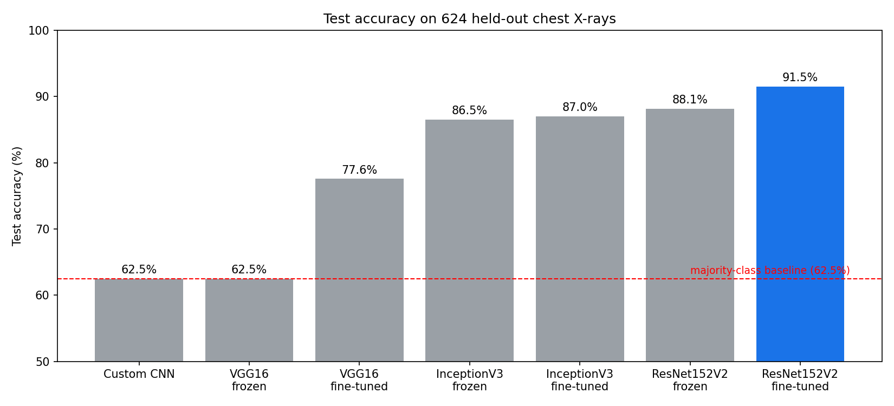
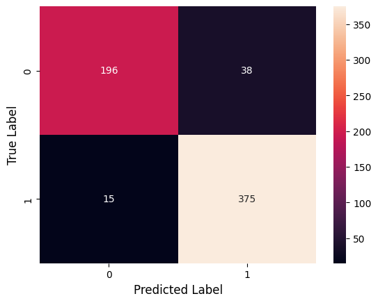
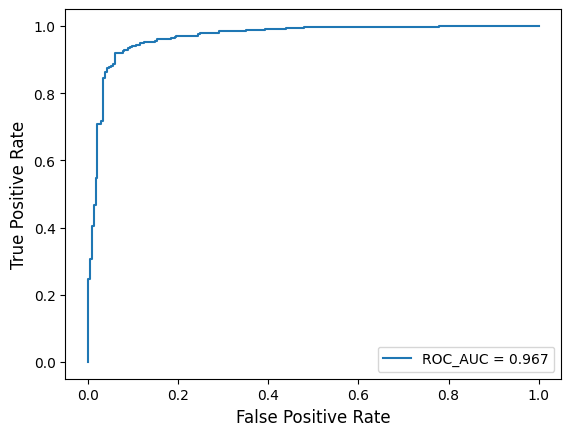

# Chest X-Ray Pneumonia Classification with CNNs, Transfer Learning & Fine-Tuning

Binary classification (**Normal vs Pneumonia**) of pediatric chest X-rays. I compare a custom CNN trained from scratch against three ImageNet-pretrained architectures (VGG-16, InceptionV3, ResNet152V2), each used first as a **frozen feature extractor** and then **fine-tuned**.

**Best model: fine-tuned ResNet152V2 - 91.5% test accuracy, 0.967 ROC-AUC, 96% pneumonia recall.**

> ⚠️ Educational project for my Computer Vision Course. Not a medical device and not for clinical use.

---

## Results

Evaluated on the 624-image held-out test set.

| # | Model | Strategy | Val acc | Test acc |
|---|-------|----------|---------|----------|
| 1 | Custom CNN | From scratch | 74.3% | 62.5% |
| 2 | VGG-16 | Frozen base | 74.6% | 62.5% |
| 3 | VGG-16 | Fine-tuned (last 4 layers) | 86.8% | 77.6% |
| 4 | InceptionV3 | Frozen base | 94.4% | 86.5% |
| 5 | InceptionV3 | Fine-tuned (last 20 layers) | - | 87.0% |
| 6 | ResNet152V2 | Frozen base | 96.9% | 88.1% |
| 7 | **ResNet152V2** | **Fine-tuned (last 13 layers)** | 95.3% | **91.5%** |



### Best model in detail (ResNet152V2, fine-tuned)

| Class | Precision | Recall | F1 | Support |
|-------|-----------|--------|----|---------|
| Normal | 0.93 | 0.84 | 0.88 | 234 |
| Pneumonia | 0.91 | 0.96 | 0.93 | 390 |

Accuracy **0.915**, ROC-AUC **0.967**. Confusion matrix: 196 TN, 38 FP, 15 FN, 375 TP.

| Confusion matrix | ROC curve |
|---|---|
|  |  |

### Observations

- **The custom CNN and frozen VGG-16 did not learn.** Their 62.5% test accuracy equals the share of pneumonia images in the test set (390/624), meaning they effectively predict "Pneumonia" for everything. A likely contributor for VGG-16 is that I only rescaled pixels by 1/255 rather than using VGG's own preprocessing, combined with a very low learning rate and early stopping.
- **Transfer learning clearly helps** on this small dataset: frozen ResNet152V2 and InceptionV3 reach 86-88%.
- **Fine-tuning ResNet152V2 gave the best result**: unfreezing the last 13 layers at a learning rate of 2e-6 took test accuracy from 88.1% to 91.5% and test loss from 0.297 to 0.235.
- In a screening context false negatives are costlier than false positives, so the 96% pneumonia recall is the useful number. The trade-off is that 16% of healthy X-rays are flagged as pneumonia.

## Dataset

[Labeled Chest X-Ray Images (v3)](https://www.kaggle.com/tolgadincer/labeled-chest-xray-images), a version of the Kermany et al. pediatric pneumonia dataset: 5,856 anterior-posterior chest X-rays from patients aged 1-5 at Guangzhou Women and Children's Medical Center.

- Train folder (5,232 images) split 80/20 (stratified) into **4,185 train / 1,047 validation**
- **624 test images** (234 Normal, 390 Pneumonia)
- Classes are imbalanced (~74% pneumonia in train)

The dataset is **not** included in this repo. The notebook downloads it with `kagglehub`.

## Method

- **Input:** 224×224 RGB, pixels rescaled to [0, 1]
- **Augmentation (train only):** zoom ±10%, width/height shift ±10%
- **Loss / head:** binary cross-entropy, sigmoid output; pretrained models use GlobalAveragePooling → Dense(128, ReLU) → Dropout → Dense(1)
- **Phase 1 (frozen):** base model frozen, Adam at 5e-5
- **Phase 2 (fine-tune):** unfreeze the last N layers, Adam at 2e-6
- **Callbacks:** EarlyStopping (patience 5, restore best weights), ReduceLROnPlateau (factor 0.2, patience 2)
- **Seed:** 42

## Repository structure

```
├── chest_xray_pneumonia_classification.ipynb   # full experiment
├── assets/                                     # figures used in this README
├── requirements.txt
└── README.md
```

## How to run

**Easiest: Google Colab (GPU).** Click the Colab badge above, set Runtime → GPU, and run all cells. The last cell (an upload-and-predict demo) uses `google.colab` and only works in Colab.

**Locally:**

```bash
git clone https://github.com/YOUR_USERNAME/YOUR_REPO.git
cd YOUR_REPO
pip install -r requirements.txt
jupyter notebook chest_xray_pneumonia_classification.ipynb
```

You need Kaggle credentials configured for `kagglehub` to download the dataset. A GPU is strongly recommended (ResNet152V2 is slow on CPU).

## Limitations & future work

- Small, single-centre, pediatric-only data; results may not generalise to other hospitals, scanners or adult patients.
- The best model was selected by comparing test scores across several candidates, so its test accuracy is slightly optimistic. A proper nested validation or a separate untouched test set would fix this.
- Use each architecture's own `preprocess_input` (especially VGG-16 and ResNet152V2) instead of 1/255 scaling.
- Add class weighting, longer fine-tuning, and stronger augmentation.
- Add Grad-CAM to check that the model looks at lung regions rather than artefacts.
- Report k-fold results with confidence intervals.

## Credits

The base pipeline (data loading, custom CNN, ResNet152V2 transfer learning and fine-tuning) is adapted from a publicly available Kaggle notebook for the Labeled Chest X-Ray Images dataset. I could not locate the original author. If you are the author, please open an issue and I will add credit.

My additions: the VGG-16 and InceptionV3 experiments (frozen and fine-tuned), the cross-architecture comparison and analysis, and the upload-and-predict demo.

Dataset: Kermany, D. S. et al., *Identifying Medical Diagnoses and Treatable Diseases by Image-Based Deep Learning*, Cell, 2018.

